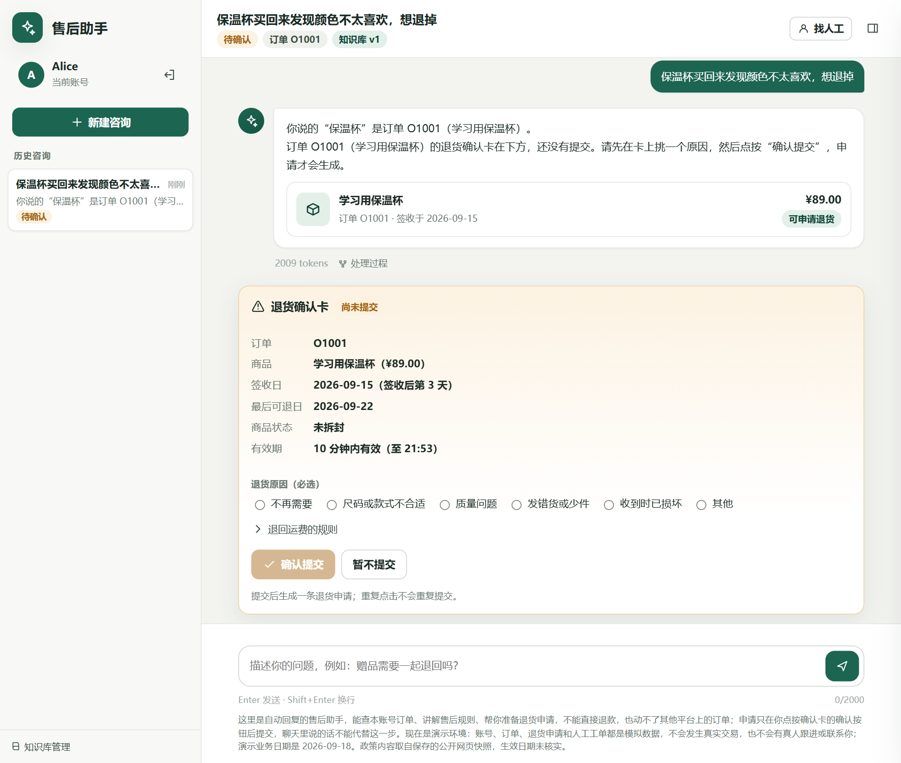
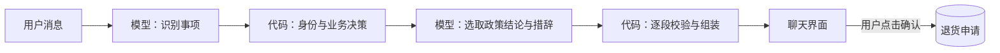

# 电商售后客服 Agent

一个中文售后客服应用，支持订单查询、退货确认、人工工单，以及接入知识发布后的政策问答。模型负责理解用户和组织表达，代码负责身份、资格与业务操作。

> 本项目是个人作品，使用模拟账号与订单，没有接入真实交易或真人客服。默认离线演示不调用模型 API；开发过程中使用了 AI 编程助手。



截图使用真实模型与模拟订单；本地默认使用关键词脚本，聊天措辞可能不同。

## 功能

- **订单与退货**：只查询当前账号的订单；符合条件时生成确认卡，用户选择原因并点击后才提交申请。
- **多事项交互**：拆分一条消息中的多个需求，分别处理；提交退货后仍可继续会话。
- **人工工单**：支持主动找人工、投诉转交和撤回；每个会话至多一张未关闭工单。
- **政策与知识库**：接入匹配的知识发布后，呈现政策结论、适用条件和来源，并支持卡片管理与版本发布。

## 快速开始

需要 Python 3.11+。以下命令使用 Windows PowerShell；本项目的自动化验证环境也是 Windows。

```powershell
git clone https://github.com/GoBackwards/aftersales-agent.git
cd aftersales-agent
python -m venv .venv
.\.venv\Scripts\python.exe -m pip install -r requirements.txt
.\run.ps1 app
```

打开 [本地聊天页](http://127.0.0.1:8765)，选择 Alice 登录。可以查看订单、点击“申请退货”，或使用“找人工”创建模拟工单。服务仅监听本机。

默认使用离线关键词脚本。要使用真实模型，复制配置并填写自己的 API key：

```powershell
Copy-Item .env.example .env
# 在本地编辑 .env，填写 LLM_API_KEY
.\run.ps1 app --live
```

真实模型模式会产生 API 费用。`.env`、会话数据库与请求日志均被 Git 忽略。

| 选项 | 用途 |
|---|---|
| `--port 8765` | 本机服务端口 |
| `--data-dir var/app` | 会话、凭据与日志目录 |
| `--knowledge-store var/knowledge-store` | 已构建且与卡片目录匹配的知识发布 |
| `--live` | 使用 `.env` 中配置的真实模型 |

**政策数据说明：** 仓库包含 24 张政策卡片，但不分发其依赖的公开网页快照。干净克隆默认可体验订单、退货和工单；完整政策问答与知识库管理需要匹配的知识发布。卡片由 AI 辅助整理，人工内容审核与政策有效期核验尚未完成。

## 实现



常规流程使用一至两次模型调用；失败时允许有限重试，默认每轮最多 8 次尝试。模型通过严格 JSON Schema 返回结构化结果。退货写入仅由确认接口执行，存储层处理幂等、并发、运行租约与失败恢复。

更详细的模块与数据说明见 [架构](docs/architecture.md)。

## 验证

```powershell
.\.venv\Scripts\python.exe -X utf8 -m unittest discover -s tests
.\.venv\Scripts\python.exe -X utf8 scripts/eval/golden.py
.\.venv\Scripts\python.exe -X utf8 scripts/check_imports.py
```

测试使用模拟模型和临时数据库，不读取 `.env`、不调用外部模型。黄金场景通过本机 HTTP 验证业务响应与数据库状态；依赖外部知识发布的场景在数据缺失时明确跳过。测试结果衡量工程行为，不代表真实客服任务成功率。

## 目录

```text
support_agent/     产品代码与网页
knowledge/         政策卡片目录
tests/             产品测试与离线场景
scripts/           离线场景运行器、模块导入检查
docs/              架构说明与演示截图
```
