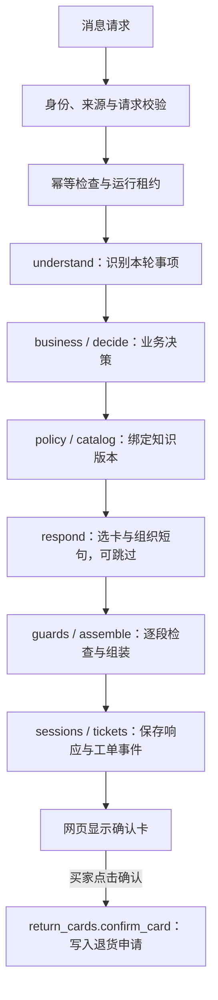

# 架构

这是运行在本机的售后客服演示。模型识别用户意图、选择政策卡片并组织短句；代码控制订单归属、退货资格、确认卡、工单和最终显示内容。

## 技术与调用流

- 后端：Python 3.11+、Pydantic、标准库 HTTP 服务与 SQLite。
- 前端：原生 HTML、CSS、JavaScript，无前端构建步骤。
- 模型接入：兼容 Chat Completions 的接口；默认离线模式使用关键词脚本，`--live` 才调用真实模型。
- 编排：显式函数调用。通常每轮调用模型 1–2 次；结构修正与重试共享每轮最多 8 次模型请求尝试的预算。

规划使用结构化事项，订单引用只在当前账号的订单中解析。纯出卡、找人工等已由代码完成的轮次可跳过答复模型。政策目录启用时，其完整紧凑视图进入答复上下文，由模型选择其中的结论。

## 关键边界

- `ReturnCards.confirm_card` 是退货申请的唯一写入路径；聊天里的“确认”不能提交申请。确认接口校验身份、卡片状态、版本和原因。
- 退货资格由 `domain.py` 的模拟规则计算，模型不能自行改变；模型规划和答复没有提交退货的工具。
- `sessions.py` 负责请求幂等、运行租约和事务；相同请求标识不能承载不同内容。
- 模型短句经过 `guards.py` 检查，涉及无记录的完成声称、无据数字或联系方式、他人订单号、密码验证码和追问退货原因等内容时会被移除。
- 工单在轮次完成的事务中创建或追加；每个会话至多一张未关闭工单。工单仅是本地模拟记录，没有真人跟进。
- HTTP 服务只监听本机回环地址，检查 Host/Origin，并以服务器端身份过滤订单与会话。演示登录用于本机体验。

## 数据与政策知识

`domain.py` 内置两位模拟买家和五笔订单，业务日期固定。账号、订单、退货和工单均不连接真实交易系统。SQLite、演示凭据和请求日志写入 `--data-dir` 指定的目录，默认是 `var/app`；这些运行数据不进入版本库。

`knowledge/graph-policy-cards-v1.json` 是政策卡片目录，也供文字守卫读取，运行时必须保留。它不能单独充当政策知识源：目录中的 `knowledge_release_id`、`corpus_sha256` 以及逐条引用必须与完整知识发布匹配。

知识发布包含政策语料及其引用资产、结构与关系数据、支持范围和审核记录；发布清单按内容寻址，并通过激活指针选择版本。加载时校验哈希、发布绑定和引用原文，不匹配则拒绝启用。知识库管理在固定发布上维护卡片版本和补充来源。

**公开仓库不分发原始网页快照和对应的完整知识发布，因此默认政策问答与知识库管理不可用。** 订单查询、退货确认和模拟工单仍可演示。若已有与目录匹配的完整发布存储，可用 `--knowledge-store <目录>` 接入；不能用任意 JSON 文件或测试夹具替代它。

卡片由 AI 整理，人工内容审核未完成，来源生效日期未核实。哈希与逐字引用校验只证明本地来源一致性，不能证明政策语义正确或当前有效。

## 运行与验证边界

`.env` 仅用于本地真实模型配置，离线模式无需 API 密钥。部署或分发时应保留 `support_agent/web/` 静态资源与 `knowledge/`，排除 `.env`、运行数据库、凭据和日志。

离线测试使用脚本化模型或合成数据；依赖未分发知识发布的检查会跳过。通过这些检查不等于真实模型的任务成功率或语义准确率。
